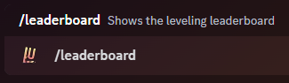
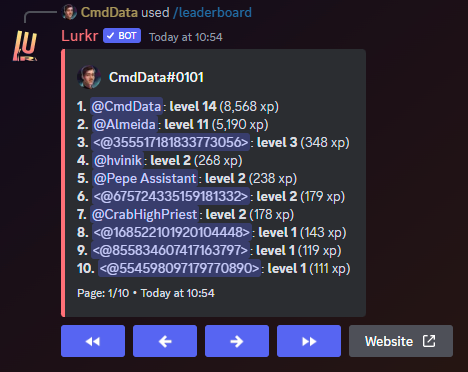

### Description

This command can be used to view the leveling leaderboard for the server that you're in. The leaderboard will only show
up if the server has leveling enabled and if there are users who have already earned levels in the appropriate channels.

The embedded message has ⏪, ◀, ▶ and ⏩ buttons, which when pressed by the command author turn the leaderboard one page
(◀ ▶) or five pages (⏪ ⏩) at a time. A **Website** button next to them opens the server's web leaderboard. A total of
10 users can be listed on the same page, and are shown what level they are and how much XP they have gained.

You can see as many leaderboard entries as your current server plan will allow. You can check the limits on the Patreon
Perks page!

[View documentation](../premium-perks)

### Command Structure

```
/leaderboard
```





### Permission

- N/A **(User)**
- `Embed Links` **(Bot)**
