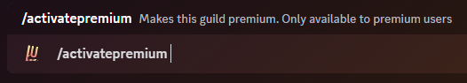

## Description

This command can be used to activate your Lurkr Ultimate perks (the $5 Patreon tier) on one server. If you already
activated them on another server, they are moved to the server you run the command in.

If you want to activate premium on your server, consider checking out the many [Premium Perks](../premium-perks) you
will get!

## Command Structure

```
/activatepremium
```



## Permission

- N/A **(User)**
- N/A **(Bot)**
