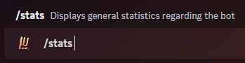

### Description

<Callout type="warning">This is a diagnostic command, not intended for regular users.</Callout>

This command can be used to display the total number of guilds across all shards, total number of users, total number of
shards, latency to the API, total memory usage, total uptime, and the shard number your server is currently being hosted
on. Below the message are buttons linking to the dashboard, the bot's invite and the vote page.

### Command Structure

```
/stats
```



### Permission

- N/A **(User)**
- `Embed Links` **(Bot)**
